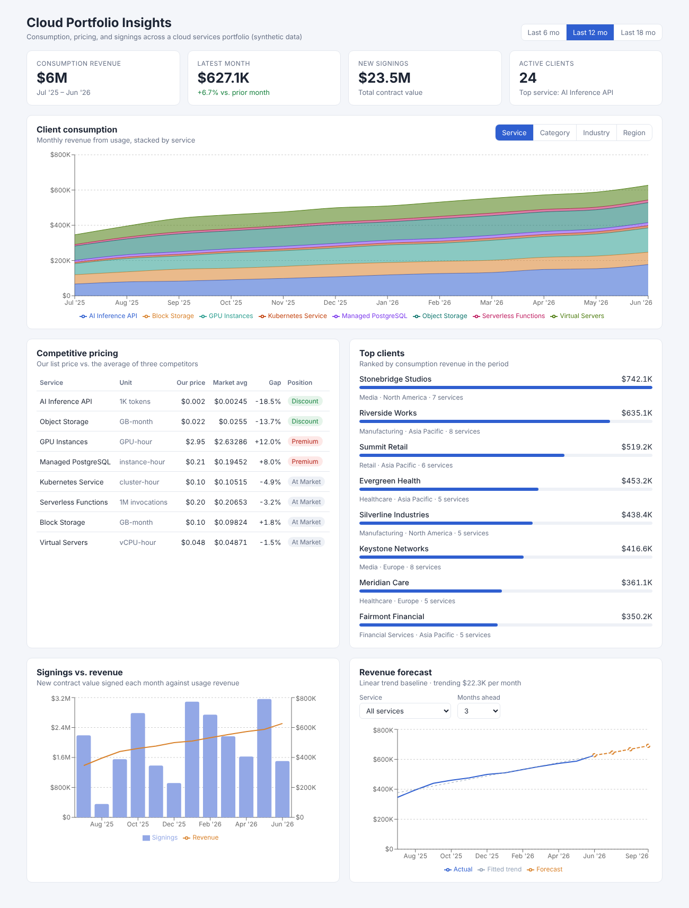

# Cloud Portfolio Insights

A small analytics app for a cloud services portfolio. It answers the questions a product or pricing team asks every week: how much are clients consuming, which services are driving revenue, where our prices sit against competitors, how new signings compare with actual usage, and where revenue is heading.

The backend is a Flask 3 API with SQL queries running on SQLite. The front end is React 18 with TypeScript, built with Vite, with Zustand for state and Axios for API calls.



All of the data is synthetic. The seed script generates 8 cloud services, 3 competitors, 24 clients, and 18 months of usage and contract signings. It uses a fixed random seed, so everyone who runs it gets the same numbers.

## What's on the dashboard

- **KPIs.** Consumption revenue for the period, the latest month and its month-over-month change, total new signings, and active clients.
- **Client consumption.** Monthly revenue stacked by service, category, industry, or region. This is the main view for spotting which part of the portfolio is growing.
- **Competitive pricing.** Our list price for each service against the average of three competitors, with the gap labeled premium, discount, or at market (within 5%). It's sorted by the size of the gap, so the services most worth a pricing review come first.
- **Top clients.** Ranked by consumption revenue, with industry, region, and how many services each one uses.
- **Signings vs. revenue.** Contract value signed each month next to usage revenue. Signings are lumpy and revenue is smooth, so looking at them side by side tells you whether new business is actually turning into consumption.
- **Revenue forecast.** A linear trend projection for the whole portfolio or a single service, 3, 6, or 12 months ahead.

The period toggle at the top (6, 12, or 18 months) refetches everything.

## Project layout

```
cloud-portfolio-insights/
  backend/
    app.py            Flask app and routes
    analytics.py      the SQL queries and calculations behind each endpoint
    db.py             SQLite connection and schema
    seed.py           generates the synthetic dataset
    tests/            pytest tests for the API
    requirements.txt
  frontend/
    src/
      api/            typed Axios client and response types
      store/          Zustand store (filters, data, loading and errors)
      components/     one component per dashboard panel
      App.tsx
    vite.config.ts    proxies /api to Flask during development
  docs/
    dashboard.png
```

## How to Run it

Run the backend and front end in two terminals.

**Backend**

```
cd backend
python -m venv venv
source venv/bin/activate        # Windows: venv\Scripts\activate
pip install -r requirements.txt
python app.py
```

The API runs at `http://localhost:5000`. The first time it starts, it builds `portfolio.db` from the seed script. To regenerate the data, delete that file or run `python seed.py`.

**Front end**

```
cd frontend
npm install
npm run dev
```

Open `http://localhost:5173`. Vite forwards any request starting with `/api` to Flask, so you don't need to configure anything. If the API isn't running, the page tells you instead of showing empty charts.

**Tests**

```
cd backend
pytest
```

There are 10 tests. Among other things, they check that the consumption breakdown adds up to the same total as the summary, that bad parameters return a 400 with a clear message, and that an unknown service returns a 404.

## The data model

Five tables:

| Table | What it holds |
|---|---|
| `services` | Each cloud service, its category, billing unit, and our list price |
| `competitor_prices` | What each competitor charges for the same service |
| `clients` | Client name, industry, and region |
| `usage` | Units consumed per client, per service, per month |
| `signings` | New contracts: client, month signed, total contract value |

Revenue is never stored. It's calculated in SQL as units consumed times list price, so a price change shows up everywhere immediately and there's no second copy of the numbers to fall out of sync.

The seed data has some realistic patterns built in. AI inference and GPU usage grow much faster than storage and virtual servers. Clients onboard at different times. A few large accounts make up a big share of revenue. Competitor pricing varies by service, so we come out at a premium on GPUs and managed PostgreSQL and at a discount on AI inference and object storage.

## API

Every endpoint is a GET and returns JSON. Errors come back as `{ "error": "..." }`.

| Endpoint | Parameters | Returns |
|---|---|---|
| `/api/health` | | `{ "status": "ok" }` |
| `/api/services` | | All services |
| `/api/summary` | `months` (2-18, default 12) | KPI totals for the period |
| `/api/consumption` | `group_by` (service, category, industry, region), `months` | Monthly revenue per group |
| `/api/pricing` | | Our price vs. competitor average and minimum, gap %, position |
| `/api/clients/top` | `limit` (1-50), `months` | Clients ranked by revenue |
| `/api/signings` | `months` | Signings and revenue by month |
| `/api/forecast` | `service_id` (optional), `horizon` (1-12), `history` (3-18) | Actuals, fitted trend, and projected months |

Example:

```
GET /api/consumption?group_by=region&months=6
```

```json
{
  "group_by": "region",
  "groups": ["Asia Pacific", "Europe", "Latin America", "North America"],
  "series": [
    {
      "month": "2026-01",
      "Asia Pacific": 257627.56,
      "Europe": 68772.87,
      "Latin America": 58419.43,
      "North America": 124910.47
    }
  ]
}
```

## A few decisions worth explaining

**Why the forecast is just a straight line.** It's meant as a baseline, not a real forecasting model. The API returns the fitted line over the history along with the actuals, so you can see how well a straight line fits before you trust the projection. For a fast-growing service like GPUs, the gap between the two shows that growth is closer to compounding than linear, which is useful to know in itself.

**Why all the state is in one Zustand store.** Changing the period affects every panel, so the filters and the data live in one place. Components only read what they need, and the store decides what to refetch. Changing the grouping only refetches the consumption chart, while changing the period refetches everything in parallel.

**Why the API responses are typed on the front end.** `src/api/types.ts` describes every response. If a field name changes in Flask, TypeScript catches it at build time instead of the chart quietly going blank.

**Why SQLite.** It needs no setup, which keeps the project easy to run. The queries are plain SQL, so moving to PostgreSQL would mostly mean changing the connection code in `db.py`.

## Where this could go

- **Real usage data.** Swap the seed script for a loader that reads billing exports, and move to PostgreSQL.
- **Better forecasting.** Replace the linear trend with something that handles growth and seasonality, and show a confidence range.
- **Price scenarios.** Let a user change a list price and see the projected revenue impact, using historical usage as a base.
- **Account health.** Flag clients whose consumption is falling month over month, since that's usually the first sign of churn.
- **Deployment.** Containerize the backend and front end with Docker and deploy them to a cloud platform.
